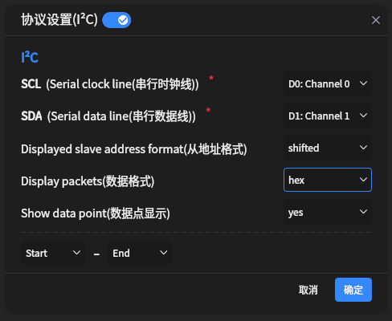

# SCCB Chip ID 读取波形证据（2026-10-24）

## 环境

- 板卡：PH1P35_FT V1 / HX1P35B_FT_40P，PH1P35MDG324
- 摄像头：ATK-MC5640（OV5640）
- 位流：`build/bitstream/top_cam_id.bit`（start_pending 修复后，2026-10-24 19:31）
- 逻辑分析仪：I2C 解码
  - CH0 = SCL（J2-32）
  - CH1 = SDA（J2-33）
  - GND = J2-30
  - 地址显示：7 位 `0x3C`（等价于写 `0x78` / 读 `0x79`）

## 解码结果

读 `0x300A`：

```text
0x3C W 0x30 0x0A [SR] 0x3C R 0x56 NA
```


读 `0x300B`：

```text
0x3C W 0x30 0x0B [SR] 0x3C R 0x40 NA
```


解码器设置：



## 结论

- `0x56` + `0x40` = Chip ID `0x5640`，与 OV5640 一致。
- `[SR]` 为 repeated START，符合当前 RTL 的读时序。
- 地址/数据字节的 ACK 为低；最后一次读的 `NACK` 是 SCCB 的 NA 位，
  属于正常结束，不是错误。
- 与上板 LED 现象一致：LED1 闪烁，LED2/3/4 常亮。

## 边界

本证据只验证 SCCB 读 Chip ID；未验证 DVP 数据、PCLK 采样、HDMI 输出。
